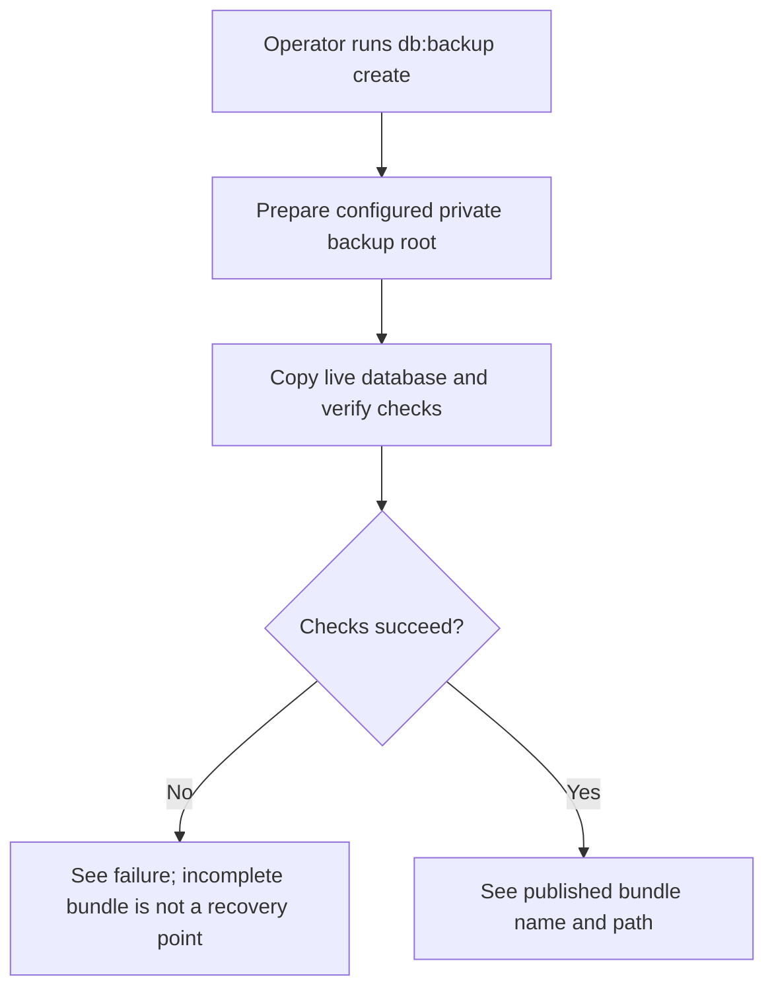
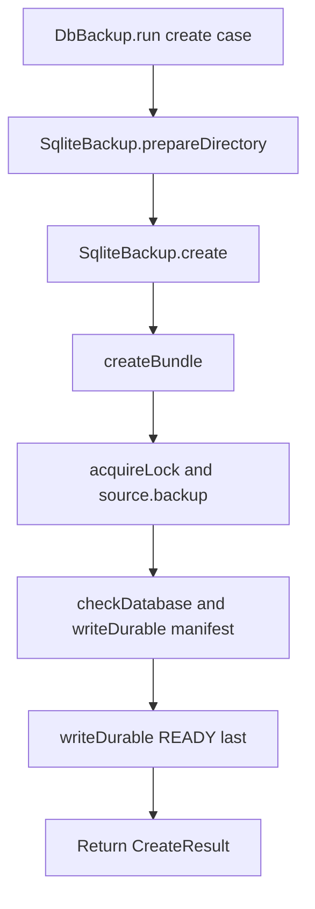

# User story format and maintenance guide

Copy the example into a stable path such as `user-stories/backup/US-BACKUP-01-create-bundle.md`. The `../../` source links are relative to that copied story file. Replace its content with verified behavior and preserve this self-contained guidance when reusing the template.

A story records one meaningful action and why it matters. Use real operator roles, Ace command names and API options. Keep product contracts in authoritative repository docs, operational instructions in guides, and runnable scenarios in tests.

## Story example

````markdown
# US-BACKUP-01 — Create a verified backup bundle

As a host operator, I want to create a verified SQLite backup bundle so that a crash-safe recovery point is available for the configured database.

**Status:** Operator; source-reviewed command, not runtime-tested.
**Access:** Host operator with access to the live database and a private configured backup directory.
**Entry:** `node ace db:backup create`.
**Documentation:** [Create command](../../README.md#commands).
**Source:** [DbBackup.run](../../commands/db_backup.ts), [createBundle](../../src/bundles.ts).
**Coverage:** [Create tests](../../tests/create.spec.ts).

## Acceptance criteria

- The command prepares the configured directory, then `SqliteBackup.create()` holds the backup lock while copying and validating the database.
- The bundle is published only after `db.sqlite`, manifest and READY marker are durable; incomplete bundles are removed or remain unpublished if cleanup fails.
- A WAL warning is shown when required WAL is not configured; a source, lock or integrity failure exits nonzero.

## User flow



## Code flow

Scope: Ace action through bundle publication; scheduling remains host-owned.



**Code references:** [command](../../commands/db_backup.ts), [service](../../src/sqlite_backup.ts), [bundle creation](../../src/bundles.ts), [create tests](../../tests/create.spec.ts).
````

## Criteria for actions without input

For an action without input, use concise observable results instead of an empty field table. For example: `- **List** prints only bundles with a READY marker, oldest first.`

For command inputs, list each exact flag/argument, type, required/default state, valid values, and which action accepts it. For forms, include exact labels, control types, constraints, options, dependencies, visibility and confirmation controls.

## Writing and maintenance rules

- Give each independently useful outcome its own story. Create, list, verify, prepare restore and prune are distinct actions.
- Include Status, Access, Entry, Documentation and Source. State when no separate guide exists. Coverage is optional; a test link does not claim that test ran.
- Keep one action and its meaningful refusal/failure paths together. Describe exact options and observable outputs; do not turn stories into backend test scripts.
- Keep identifiers and filenames stable. Preserve disappeared historical intent with an explicit availability state unless retirement is authorized.
- Maintain README, REFERENCE, COVERAGE and GAPS with the stories. “New” means newly documented, not newly implemented.
- Trace producers and consumers, persistence and interruption cleanup. Distinguish bundle publication from a staged restore copy and from switching a live database.
- For unavailable stories, label user flow unavailable and show the missing trigger plus retained code support in Code flow.

## Availability definitions

| Status   | Meaning                                                                      |
| -------- | ---------------------------------------------------------------------------- |
| Current  | Exposed under stated role, configuration and conditions                      |
| Hidden   | Implementation remains but ordinary entry or trigger is unavailable          |
| Removed  | Historical capability has no current product entry                           |
| Demo     | Available only in a specified demo context                                   |
| Operator | Installation, hosting, backup or recovery outside an ordinary application UI |
| Planned  | Agreed target without an ordinary implemented journey                        |

Read Status with Access and Entry. A configured switch is a condition, not proof of removal. Current describes source availability, not runtime verification.

## Diagram and verification conventions

- Every story has plain-language User flow and source-backed Code flow Mermaid diagrams. Include meaningful decisions, refusal, failure, cancellation and recovery.
- Trace actual command/API entry, handler, service/helper, persistence or filesystem effect, and result. Use existing symbols and link them under Code references. Name a boundary when the flow stops early.
- Distinguish application server writes, local files and read-only operations. State whether the operation changes the live database or only stages data.
- For Hidden, Removed or Planned, mark the user flow unavailable and show the missing entry/trigger and retained support in Code flow.
- Parse changed diagrams, inspect representative rendering, and verify source links, IDs, index/matrix parity, status, and decision gaps. Syntax does not prove behavior.
- Report source review separately from runtime verification.

```

```
