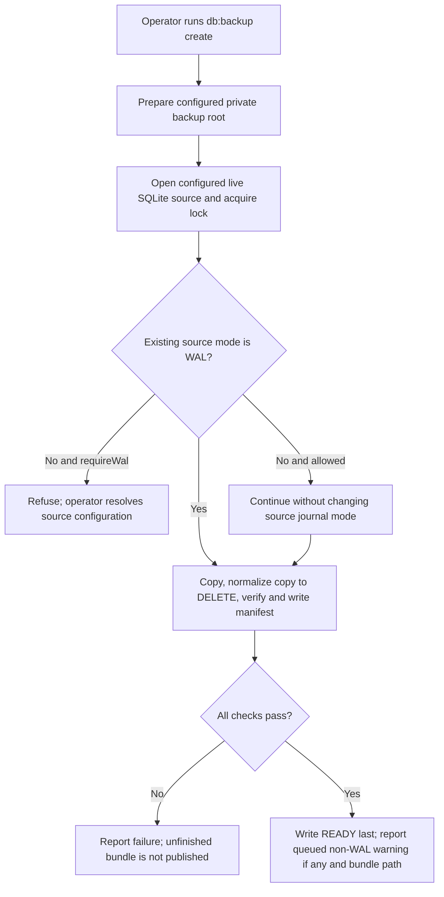
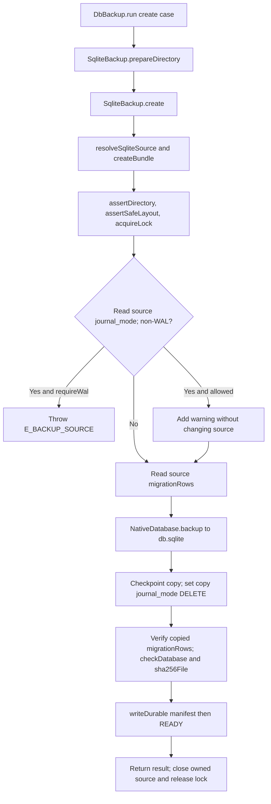

# US-OP-01 — Create a verified backup bundle

As a host operator, I want to create an immutable backup bundle from the configured Lucid SQLite database so that I have a checked recovery point.

**Status:** Operator; current Ace command and service operation.
**Access:** Host operator with a readable live database and private configured backup root.
**Entry:** `node ace db:backup create`; run as an operator task, not in a web request.
**Documentation:** [Command behavior](../../README.md#commands), [service and configuration](../../README.md#service-and-configuration).
**Source:** [DbBackup.run](../../commands/db_backup.ts), [SqliteBackup.create](../../src/sqlite_backup.ts), [createBundle](../../src/bundles.ts).
**Coverage:** [Create tests](../../tests/create.spec.ts), [durability tests](../../tests/durability.spec.ts).

## Acceptance criteria

- `DbBackup.run` prepares the configured root and calls `SqliteBackup.create()`, which resolves the configured live path, selected migration table, lock timeout and WAL requirement.
- `createBundle()` validates private directory/source layout and holds `.backup.lock` for its run. It refuses a borrowed handle with an open transaction; a borrowed handle stays open afterward.
- The copy is made using SQLite backup, journal and migration metadata are checked, `checkDatabase()` runs full integrity and foreign-key checks, and a read-only database file plus manifest are written before READY is durably written last.
- The existing source journal mode is read, not changed. A non-WAL source produces a warning unless `requireWal` makes it a refusal. The backup copy is checkpointed and normalized to `journal_mode=DELETE`. A failed create cleans up its unfinished bundle where possible and exits nonzero; cleanup failure is separately reported.
- `create` uses only configured backup directory; `--directory` is invalid for this action.

## User flow

## Code flow

Scope: Ace create action through publication and lock release.

**Code references:** [command](../../commands/db_backup.ts), [service](../../src/sqlite_backup.ts), [createBundle](../../src/bundles.ts), [durability tests](../../tests/durability.spec.ts).
