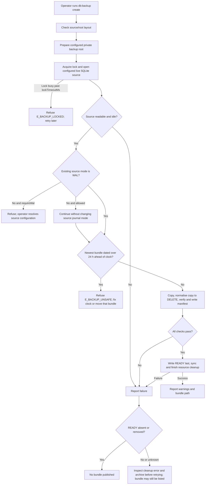
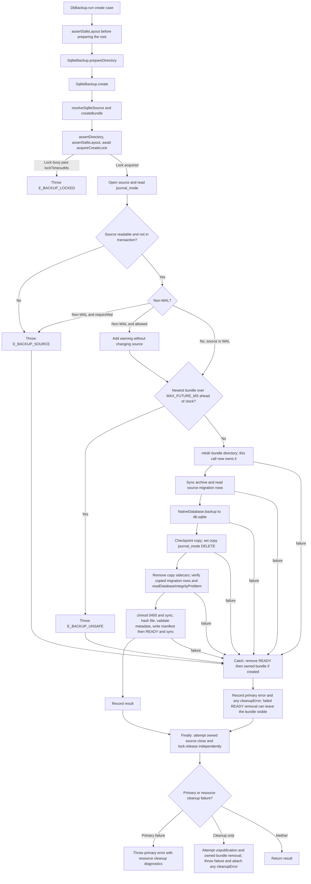

# US-OP-01 — Create a verified backup bundle

As a host operator, I want to create a verified backup bundle from the configured Lucid SQLite database so that I have a checked recovery point.

**Status:** Operator; current Ace command and service operation.
**Access:** Host operator with a readable live database and private configured backup root.
**Entry:** `node ace db:backup create`; run as an operator task, not in a web request.
**Documentation:** [Command behaviour](../../README.md#commands), [service and configuration](../../README.md#service-and-configuration).
**Source:** [DbBackup.run](../../commands/db_backup.ts), [SqliteBackup.create](../../src/sqlite_backup.ts), [createBundle](../../src/bundles.ts).
**Coverage:** [Create tests](../../tests/create.spec.ts), [durability tests](../../tests/durability.spec.ts).

## Acceptance criteria

- `DbBackup.run` checks the source/root layout before preparing the configured root and calls `SqliteBackup.create()`, which resolves the configured live path, selected migration table, lock timeout and WAL requirement.
- `createBundle()` validates private directory/source layout and takes the cooperative `.backup.lock` for creation and publication. Resource-cleanup failure can trigger bundle cleanup after the lock-release attempt. It relies on trusted archive parents and cooperating writers. It refuses a borrowed handle with an open transaction; a borrowed handle stays open afterward.
- The copy is made using SQLite backup, journal and migration metadata are checked, `readDatabaseIntegrityProblem()` runs full integrity and foreign-key checks, and a read-only database file plus manifest are written before READY is durably written last.
- Verification uses package-opened SQLite connections. SQL functions, collations or extensions registered only on the application's connection are not registered on those handles. A schema that depends on them, such as an expression index using an application-registered function, may fail verification; create fails closed and does not publish the bundle. There is no connection initialiser hook.
- The existing source journal mode is read, not changed. A non-WAL source produces a warning unless `requireWal` makes it a refusal. The backup copy is checkpointed and normalised to `journal_mode=DELETE`. A failed create cleans up its unfinished bundle where possible and exits nonzero. If cleanup fails, inspect the cleanup error and the archive before retrying. A bundle may remain visible if its READY marker could not be removed.
- Create is refused with `E_BACKUP_LOCKED` when another run holds `.backup.lock` for longer than `lockTimeoutMs`, and with `E_BACKUP_UNSAFE` when the newest existing bundle is dated more than 24 hours after the clock; the operator fixes the clock or moves that bundle, then retries.
- `create` uses only configured backup directory; `--directory` is invalid for this operation.

- Create compares every ordered row of the source migration journal with the copy. A missing journal omits migration metadata. Unsupported metadata prevents publication. [Adoption scenarios](../../tests/adoption.spec.ts)

## User flow

## Code flow

Scope: Ace create operation through publication, failure cleanup and lock release. `assertDirectory`, `assertSafeLayout` and `acquireCreateLock` failures happen before the lock-owning `try/finally`, so a lock that was never acquired is not released.

**Code references:** [command](../../commands/db_backup.ts), [service](../../src/sqlite_backup.ts), [createBundle](../../src/bundles.ts), [durability tests](../../tests/durability.spec.ts).
