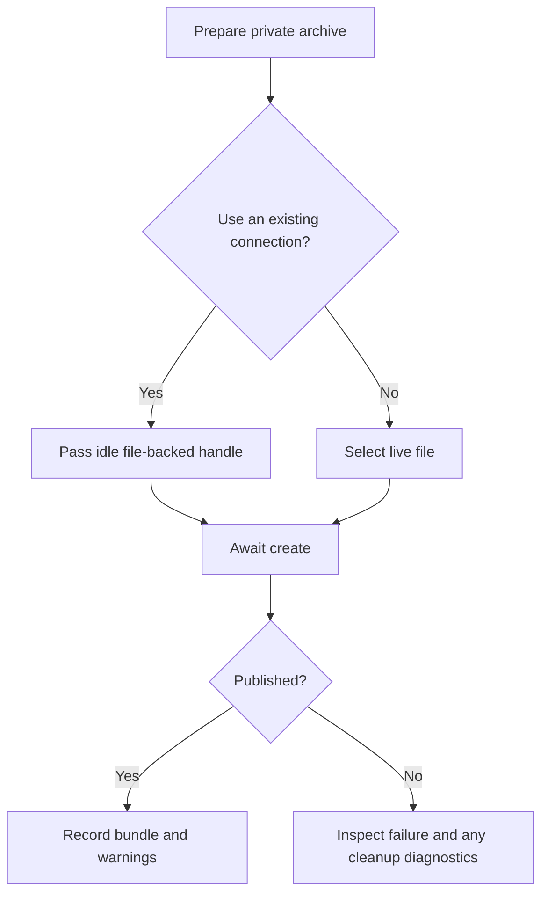
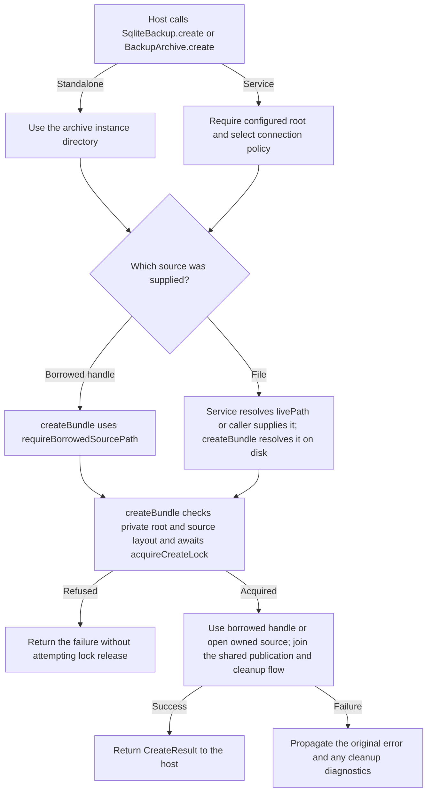

# US-INT-01 — Run backups from a host application

As an application developer, I want to create a bundle from an existing SQLite handle or a configured file so that a host-run job can publish a recovery point and retain control of its connection.

**Status:** Public API.
**Access:** Host developer with an existing private root and a readable file-backed SQLite source.
**Entry:** Resolve the container singleton `sqlite.backup`, import the boot-aware `@kevinjohn/adonisjs-sqlite-backup/services/main`, or use `new BackupArchive(directory).create(options)`.
**Documentation:** [Service and configuration](../../README.md#service-and-configuration).
**Source:** [Service](../../src/sqlite_backup.ts), [standalone archive](../../src/backup_archive.ts).
**Coverage:** [Adoption scenarios](../../tests/adoption.spec.ts), [application tests](../../tests/app.spec.ts).

## Acceptance criteria

- A host can call `checkSource()` to resolve and open its configured file read-only, probe the schema and close the probe without creating a bundle. The application chooses when to perform this check. `livePath()` resolves the selected connection on each call. Both require an enabled directory.
- Prepare the private root with `backup.prepareDirectory()` or `archive.prepareDirectory()` before calling create directly. With no handle, the service opens the configured file. Standalone callers supply `livePath`. The package closes its own handle on success and failure.
- With `backup.create({ database })` or `archive.create({ source: { database } })`, the main file comes from the supplied handle. An unreadable or memory-only handle, an active transaction or a source under the archive root is refused. The caller keeps the handle and its settings. Create reads the main migration journal even with temporary tables or BigInt-mode results.
- Service `create` accepts optional `now` and `database`; without a handle it resolves the configured source. The standalone archive takes `directory` at construction. Its `create` method requires exactly one of `livePath` or `source: { database }`; optional `migrationsTable` defaults to `adonis_schema`, `lockTimeoutMs` to 0, `requireWal` to false and `now` to `Date.now`. The service derives the migration table and policy from its configuration.
- Await the result to obtain the name, path, UTC creation time, manifest and warnings. The [create story](../create-bundle/us-op-01-create-bundle.md#code-flow) traces shared publication checks and cleanup. The returned name can select a bundle for [verification](../verify-bundle/us-op-03-verify-bundle.md) or [restore preparation](../prepare-restore/us-op-04-prepare-restore.md).

## User flow

## Code flow

Scope: source selection through the shared [create publication and cleanup flow](../create-bundle/us-op-01-create-bundle.md#code-flow).

**Code references:** [Service](../../src/sqlite_backup.ts), [archive](../../src/backup_archive.ts), [source lookup](../../src/source.ts), [create](../../src/bundles.ts).
