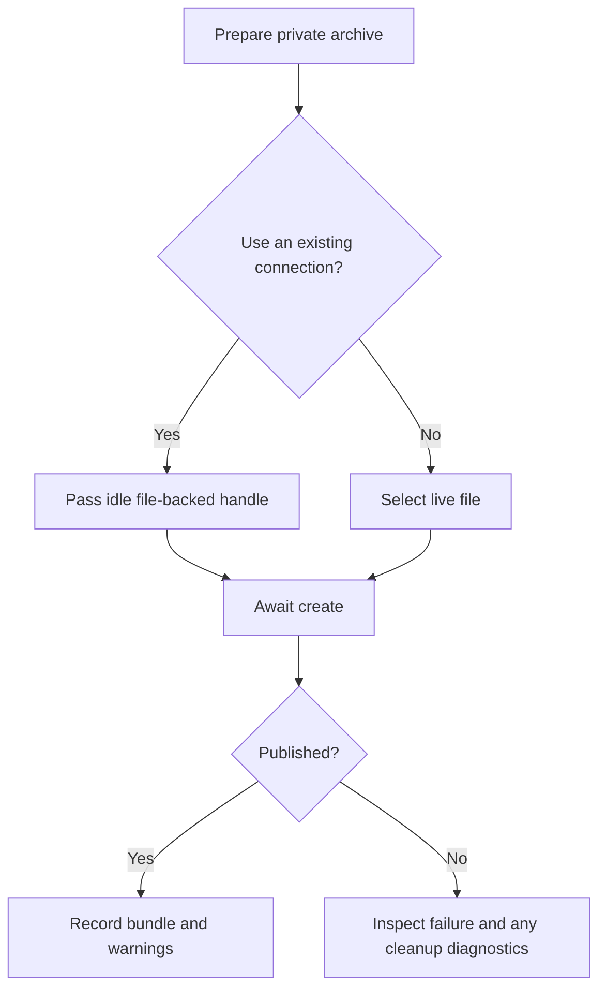
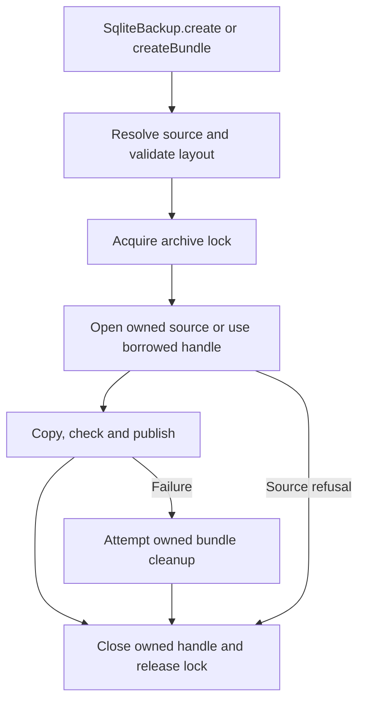

# US-INT-01 — Run backups from a host application

As an application developer, I want to create a bundle from an existing SQLite handle or a configured file so that a host-run job can publish a recovery point and retain control of its connection.

**Entry:** Resolve the container singleton `sqlite.backup`, import the boot-aware `@kevinjohn/adonisjs-sqlite-backup/services/main`, or call the standalone functions exported by the package.

## Acceptance criteria

- A host can call `checkSource()` to resolve and open its configured file read-only, probe the schema and close the probe without creating a bundle. The application chooses when to perform this check. `livePath()` resolves the selected connection on each call. Both require an enabled directory.
- Prepare the private root with `backup.prepareDirectory()` or `prepareDirectory(directory)` before calling create directly. With no handle, the service opens the configured file. Standalone callers supply `livePath`. The package closes its own handle on success and failure.
- With `backup.create({ database })` or standalone `createBundle({ directory, source: { database } })`, the main file comes from the supplied handle. An unreadable or memory-only handle, an active transaction or a source under the archive root is refused. The caller keeps the handle and its settings. Create reads the main migration journal even with temporary tables or BigInt-mode results.
- Await the result to obtain the name, path, UTC creation time, manifest and warnings. A host can list published summaries or pass the returned name to verify or restore preparation. Recovery directory overrides take precedence even when the configured directory is enabled. Service restore preparation still needs a resolvable live path to guard the target.
- Service prune checks any resolvable live path against its root. When the service has only a borrowed source and Lucid supplies no usable path, prune can still run. Standalone prune accepts the root and retention count and has no Lucid source configuration.

## User flow

## Code flow

**Source and coverage:** [Service](../../src/sqlite_backup.ts), [source lookup](../../src/source.ts), [create](../../src/bundles.ts), [adoption scenarios](../../tests/adoption.spec.ts), [application tests](../../tests/app.spec.ts), [create tests](../../tests/create.spec.ts).
