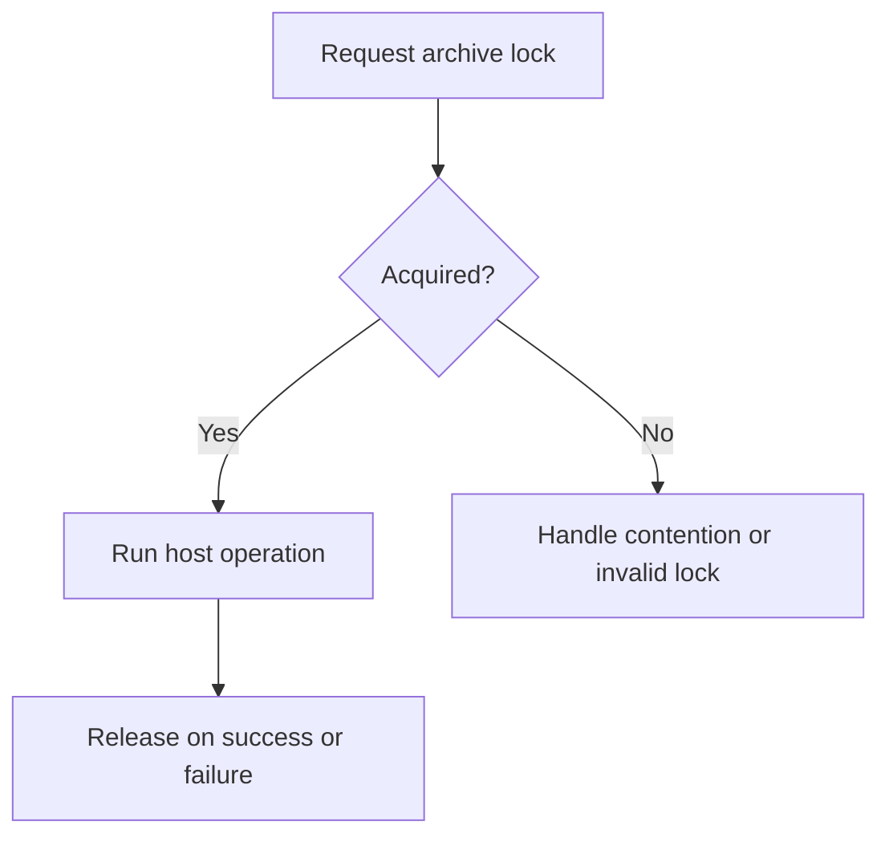
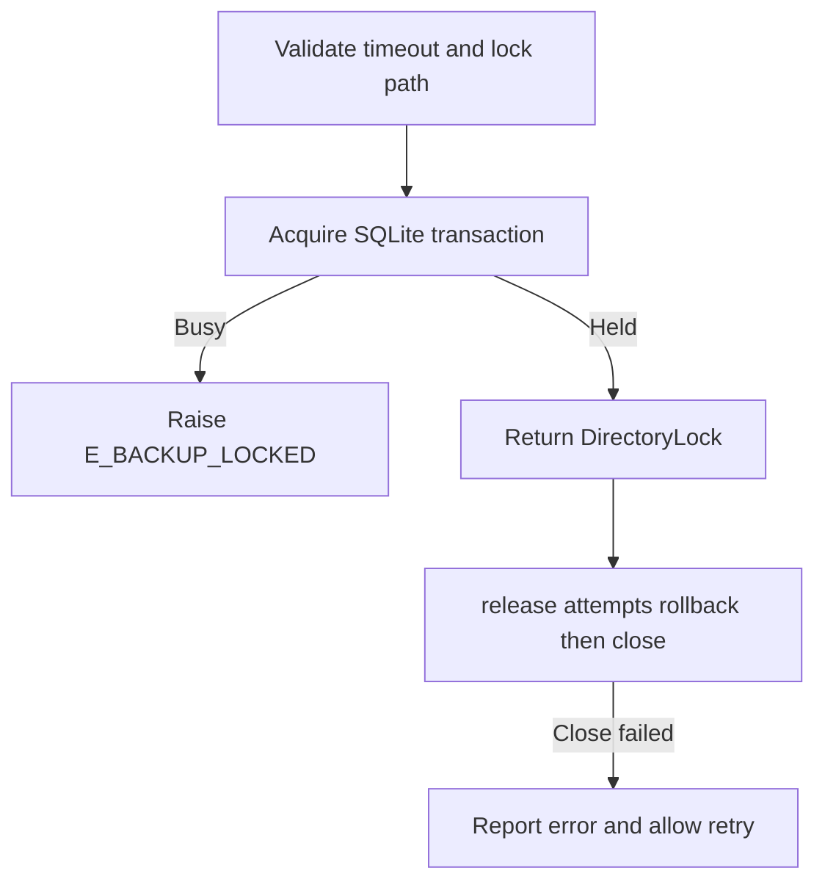

# US-INT-02 — Coordinate a host operation with archive writers

As a host developer, I want to acquire the archive's directory lock so that a custom operation can use the same exclusion mechanism as create and prune.

**Entry:** Call the package export `acquireLock(directory, timeoutMs)` on the prepared local archive. Store the returned `DirectoryLock` and call `release()` in a finally block.

## Acceptance criteria

- The synchronous helper uses zero wait by default. A timeout must be an integer between 0 and 2,147,483,647 milliseconds. Invalid values are rejected before the lock path is touched.
- Contention produces `E_BACKUP_LOCKED`. A second holder in the same process fails promptly. A competing process can acquire the lock once the holder releases it or its process dies. Verification and listing can run while this lock is held.
- Release attempts close even when rollback fails. If both fail, the caller receives both diagnostics. A failed close can be retried. Releasing an already closed lock succeeds. The lock coordinates archive writers, while stopped-server database operations use the separate [operator guard](../operator-guards/us-op-07-stopped-server-operator-command.md).
- A damaged lock file can be recovered where safe. Link safety checks can refuse recovery. The host must keep archive parents trusted and use a local filesystem.

## User flow

## Code flow

**Source and coverage:** [Lock implementation](../../src/lock.ts), [process contention, cleanup and recovery tests](../../tests/lock.spec.ts), [damaged lock regressions](../../tests/rereview.spec.ts).
