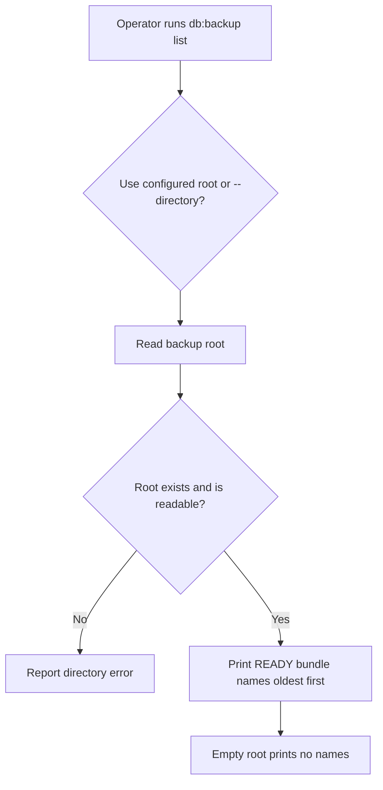
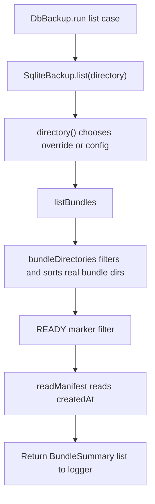

# US-OP-02 — List published backup bundles

As a host operator, I want to list READY bundles so that I can see available recovery points before verifying, restoring or pruning them.

**Status:** Operator; current Ace and public service operation.
**Access:** Operator able to read configured or explicitly selected backup directory.
**Entry:** `node ace db:backup list [--directory path]`.
**Documentation:** [Command behavior](../../README.md#commands), [bundle listing contract](../../README.md#service-and-configuration).
**Source:** [DbBackup.run](../../commands/db_backup.ts), [SqliteBackup.list](../../src/sqlite_backup.ts), [listBundles](../../src/bundles.ts).
**Coverage:** [Application command tests](../../tests/app.spec.ts), [bundle tests](../../tests/create.spec.ts).

## Acceptance criteria

| Option        | Control     | Required/default/conditions                                                  |
| ------------- | ----------- | ---------------------------------------------------------------------------- |
| `--directory` | String flag | Optional; read-only override for this action; configured directory otherwise |

- `listBundles()` includes only real bundle directories with READY, ordered oldest first, and prints bundle names.
- An existing empty directory prints no bundle names; a missing directory fails. A concurrently removed publication is skipped; a READY bundle with unreadable manifest fails and identifies the bundle.
- Listing is lock-free and does not alter bundles. The override also works when configured operations are disabled.

## User flow

## Code flow

Scope: read-only listing through bundle metadata; no lock is acquired.

**Code references:** [command](../../commands/db_backup.ts), [service](../../src/sqlite_backup.ts), [listBundles and bundleDirectories](../../src/bundles.ts), [listing contract](../../README.md#service-and-configuration).
