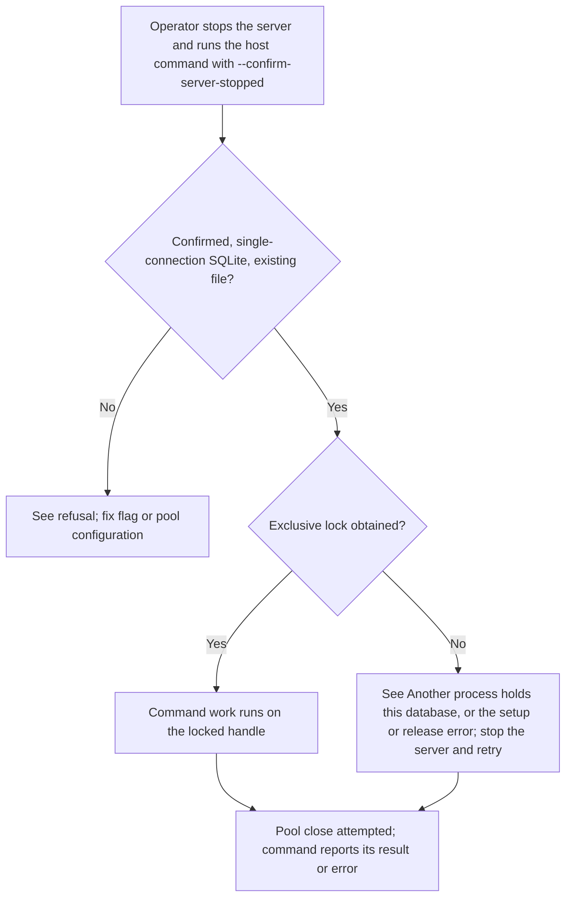
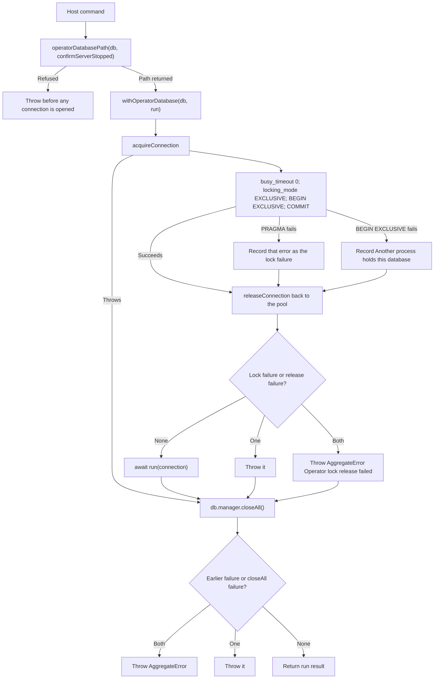

# US-OP-07 — Run a stopped-server operator command

As a host operator, I want to guard a custom Ace command with `operatorDatabasePath()` and `withOperatorDatabase()` so that it changes the SQLite database only after I confirm the server is stopped and the command holds an exclusive lock on the file.

**Status:** Operator; current public exports for host-written commands. The package ships no command that uses them.
**Access:** Host operator running a host-written command, with a Lucid primary connection that uses `better-sqlite3` with a pool of one.
**Entry:** A host command calling `operatorDatabasePath(db, confirmServerStopped)` then `withOperatorDatabase(db, run)`, typically behind a `--confirm-server-stopped` flag.
**Documentation:** [Stopped-server operator commands](../../README.md#stopped-server-operator-commands).
**Source:** [operatorDatabasePath and withOperatorDatabase](../../src/operator.ts), [package exports](../../index.ts).
**Coverage:** [Operator tests](../../tests/operator.spec.ts).

## Acceptance criteria

| Argument               | Control          | Required/default/conditions                                                                        |
| ---------------------- | ---------------- | -------------------------------------------------------------------------------------------------- |
| `db`                   | Lucid `Database` | Required; the primary connection is checked                                                        |
| `confirmServerStopped` | Boolean          | Required; `false` refuses with `Refusing without --confirm-server-stopped`                         |
| `run(connection)`      | Async callback   | Required for `withOperatorDatabase`; receives the pool's only handle, which Lucid queries also use |

- `operatorDatabasePath` is called before any connection is opened. It refuses a connection that is not `better-sqlite3` with `pool.max` of 1, an in-memory database, and a path that is not an existing regular file; it returns the file path.
- `withOperatorDatabase` sets `busy_timeout = 0` and `locking_mode = EXCLUSIVE` on the only handle and takes the lock with `BEGIN EXCLUSIVE; COMMIT`. If `BEGIN EXCLUSIVE` fails it throws `Another process holds this database; stop the server and retry`. A PRAGMA failure keeps its own error. `run` starts only after the lock setup and the connection release both succeed.
- The helpers do not detect a running server; stopping it is the operator's responsibility, confirmed through `confirmServerStopped`.
- `db.manager.closeAll()` is attempted after success and after every failure. A cleanup failure is reported: alone when nothing failed earlier, otherwise in an `AggregateError` carrying the first failure and the cleanup failure in order.

## User flow

## Code flow

Scope: the two exported helpers; the host command and its work are outside the package.

**Code references:** [operator helpers](../../src/operator.ts), [package exports](../../index.ts), [operator tests](../../tests/operator.spec.ts), [README operator contract](../../README.md#stopped-server-operator-commands).
