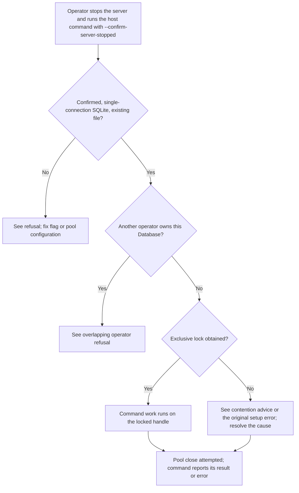
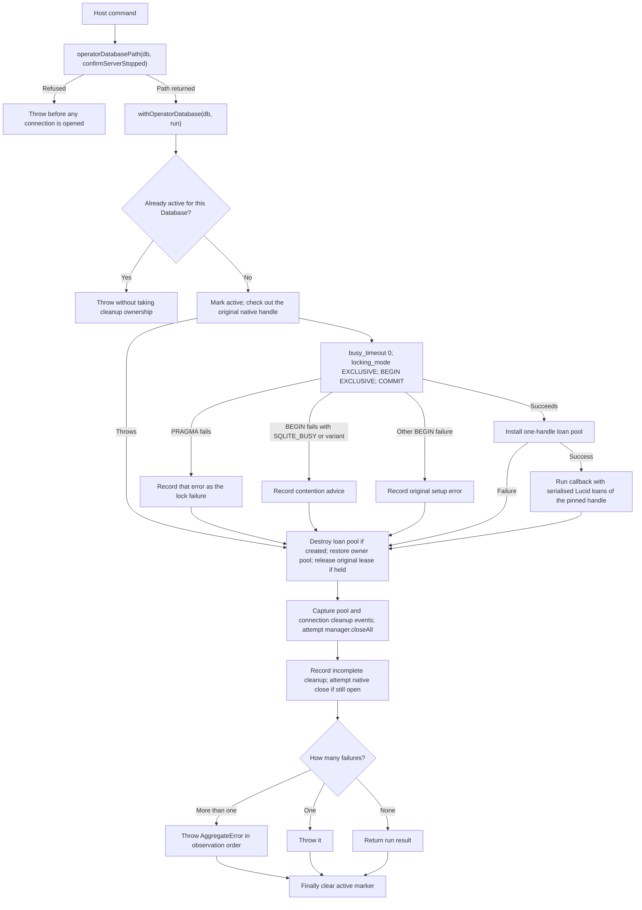

# US-OP-07 — Run a stopped-server operator command

As a host operator, I want to check the operator preconditions of a custom Ace command with `operatorDatabasePath()` and `withOperatorDatabase()` so that it changes the SQLite database only after I confirm the server is stopped and the command holds an exclusive lock on the file.

**Status:** Operator; current public exports for host-written commands. The package ships no command that uses them.
**Access:** Host operator running a host-written command, with a Lucid primary connection that uses `better-sqlite3` with a pool of one.
**Entry:** A host command calling `operatorDatabasePath(db, confirmServerStopped)` then `withOperatorDatabase(db, run)`, typically behind a `--confirm-server-stopped` flag.
**Documentation:** [Stopped-server operator commands](../../README.md#stopped-server-operator-commands).
**Source:** [operatorDatabasePath and withOperatorDatabase](../../src/operator.ts), [package exports](../../index.ts).
**Coverage:** [Operator tests](../../tests/operator.spec.ts).

## Acceptance criteria

| Argument               | Control          | Required/default/conditions                                                                                        |
| ---------------------- | ---------------- | ------------------------------------------------------------------------------------------------------------------ |
| `db`                   | Lucid `Database` | Required; the primary connection is checked                                                                        |
| `confirmServerStopped` | Boolean          | Required; `false` refuses with `Refusing without --confirm-server-stopped`                                         |
| `run(connection)`      | Async callback   | Required for `withOperatorDatabase`; receives the primary pool's only handle, which primary Lucid queries also use |

- `operatorDatabasePath` is called before any connection is opened. It refuses a connection that is not `better-sqlite3` with `pool.max` of 1, an in-memory database, and a path that is not an existing regular file; it returns the file path.
- The operator's confirmation is a precondition, not an automatic server-status probe. `withOperatorDatabase` sets `busy_timeout = 0` and `locking_mode = EXCLUSIVE` on the primary handle and takes the lock with `BEGIN EXCLUSIVE; COMMIT`. Only `SQLITE_BUSY` lock contention becomes `errors.E_BACKUP_LOCKED` with stopped-server advice and the native error as its cause. Other setup errors retain their meaning. The original native lease remains checked out throughout `run`, including when the owning pool reaps idle connections or its connection lifetime expires. Ordinary Lucid queries and transactions on the primary connection borrow that handle in sequence. The callback finishes its transactions and leaves the handle open. An overlapping call on the same `Database` throws `RuntimeException` before taking cleanup ownership.
- The helpers do not detect a running server; stopping it is the operator's responsibility, confirmed through `confirmServerStopped`.
- `db.manager.closeAll()` is attempted after success and after every failure after ownership begins; overlapping calls are refused earlier. Refused owner release and Lucid or Tarn cleanup events are reported even when their cleanup promises resolve. A cleanup failure is reported alone when work succeeded, otherwise in an `AggregateError` carrying the first failure and cleanup failures in order.

- The host receives the callback’s resolved value after successful cleanup. For a custom command that creates a backup using the pinned native handle, follow the [borrowed-source integration story](../integration/us-int-01-programmatic-backups.md) and finish any transaction first. [Operator implementation](../../src/operator.ts)

## User flow

## Code flow

Scope: the two exported helpers; the host command and its work are outside the package.

**Code references:** [operator helpers](../../src/operator.ts), [package exports](../../index.ts), [operator tests](../../tests/operator.spec.ts), [README operator contract](../../README.md#stopped-server-operator-commands).
