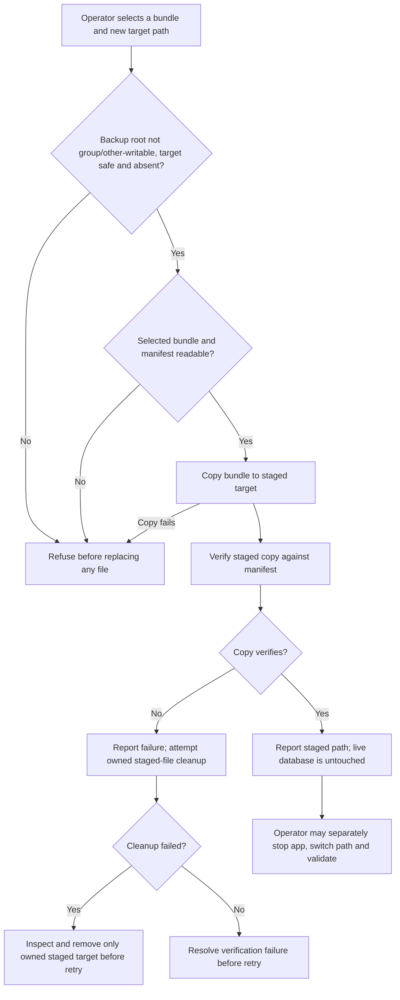
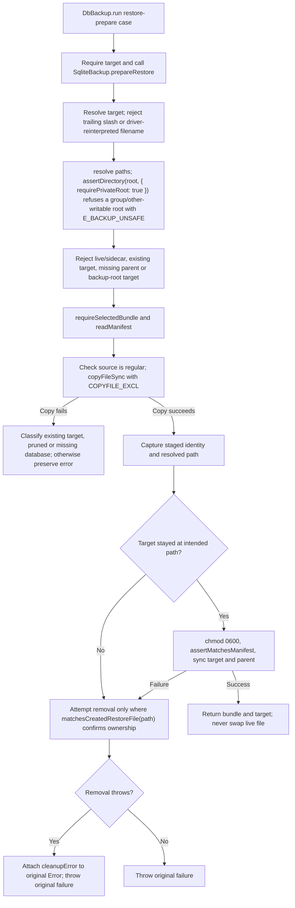

# US-OP-04 — Prepare a verified restore copy

As a host operator, I want to stage and verify a selected bundle at a new path so that I can inspect a recovery copy before deliberately switching the application to it.

**Status:** Operator; current prepare-only restore action.
**Access:** Operator who can traverse the live database path, read a backup root that is not writable by group or others (owner-only `0700` is recommended and is what `prepareDirectory()` sets), and write to an existing target folder. The package checks only that the target folder exists; keep it writable only by trusted users, because a process that can rewrite it can race or replace the staged copy ([Limits](../../README.md#limits)).
**Entry:** `node ace db:backup restore-prepare --target path [--bundle name] [--directory path]`.
**Documentation:** [Restoring](../../README.md#restoring).
**Source:** [DbBackup.run](../../commands/db_backup.ts), [SqliteBackup.prepareRestore](../../src/sqlite_backup.ts), [prepareRestore](../../src/restore.ts).
**Coverage:** [Restore preparation tests](../../tests/verify_restore.spec.ts), [path tests](../../tests/paths.spec.ts).

## Acceptance criteria

| Option        | Control     | Required/default/conditions                                                      |
| ------------- | ----------- | -------------------------------------------------------------------------------- |
| `--target`    | String flag | Required path; target file and sidecars must not exist; parent folder must exist |
| `--bundle`    | String flag | Optional named READY bundle; newest READY otherwise                              |
| `--directory` | String flag | Optional read-only backup root override; configured directory otherwise          |

- The action refuses a backup root, including a `--directory` override, that is writable by group or others (`E_BACKUP_UNSAFE`), the live database and its `-wal`, `-shm` or `-journal` sidecars, an existing target/sidecar (including dangling symlink), missing folder, or target inside backup root.
- It copies exclusively to the target, sets mode `0600`, and rechecks size, SHA-256, integrity, foreign keys and migration journal against the bundle manifest. On post-copy failure it attempts to remove only its own staged file. If removal fails, the original exception carries `cleanupError` and the owned file can remain; inspect and remove that owned staged target before retrying, never an unrelated existing target or the live database.
- If the process is interrupted after creating the target but before return, a partial or unverified target may remain. Its presence does not prove verification completed; inspect and remove only the chosen target before retrying, because retry refuses an existing target.
- Success stops at a verified copy. It never replaces the live database or changes Lucid configuration. Stopping the app, switching paths, restarting and checking data remain operator decisions; retain the old file until satisfied.
- Operation is lock-free; a concurrently pruned source may fail verification.

- Restore requires a regular marker and manifest and rejects a symbolic link or other non-regular database member before copying. The staged file passes byte, SQLite and optional migration checks before its file and parent directory are synced. [Restore implementation](../../src/restore.ts), [regular-file regressions](../../tests/verify_restore.spec.ts)

## User flow

## Code flow

Scope: prepare-only copy through verification; host-controlled cutover is outside the package.

**Code references:** [command](../../commands/db_backup.ts), [service](../../src/sqlite_backup.ts), [prepareRestore](../../src/restore.ts), [path safety](../../src/paths.ts), [README restore contract](../../README.md#restoring).
