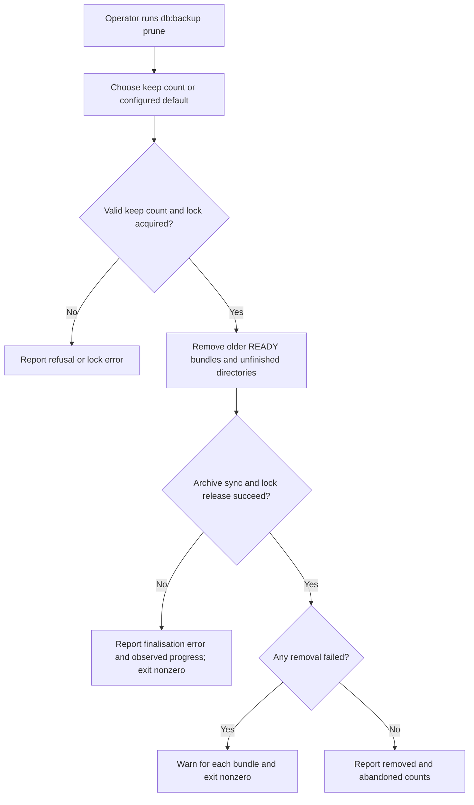
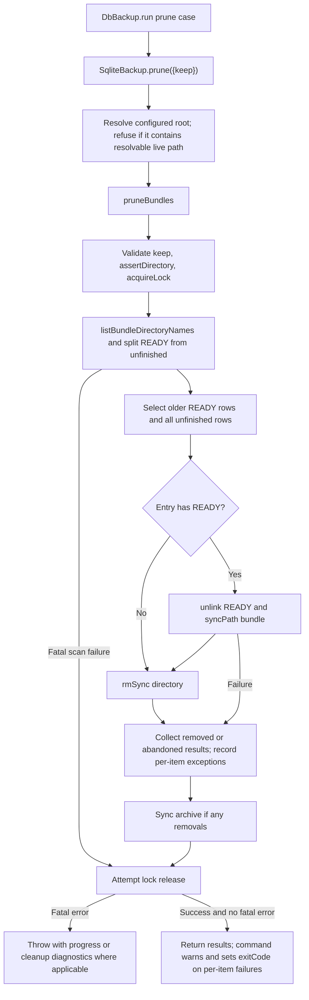

# US-OP-05 — Prune older and unfinished backup bundles

As a host operator, I want to retain only the newest configured number of READY bundles and remove abandoned incomplete directories so that the backup root stays within its retention policy.

**Status:** Operator; current Ace and public service operation.
**Access:** Operator with write access to the private configured backup root.
**Entry:** `node ace db:backup prune [--keep n]`.
**Documentation:** [Command behavior](../../README.md#commands), [startup scheduling](../../README.md#service-and-configuration).
**Source:** [DbBackup.run](../../commands/db_backup.ts), [SqliteBackup.prune](../../src/sqlite_backup.ts), [pruneBundles](../../src/prune.ts).
**Coverage:** [Prune tests](../../tests/prune.spec.ts), [lock tests](../../tests/lock.spec.ts).

## Acceptance criteria

| Option   | Control     | Required/default/conditions                                                     |
| -------- | ----------- | ------------------------------------------------------------------------------- |
| `--keep` | Number flag | Optional; defaults to configured `keep` (default 7); must be integer at least 1 |

- Under the backup lock, prune keeps newest `keep` READY bundles and removes older READY bundles plus matching unfinished directories.
- READY controls retention membership only; prune does not verify each bundle's readability or recoverability. A damaged READY bundle still counts toward `keep`, so verify recovery points with `db:backup verify` and retain a separate known-good copy before pruning when recovery matters.
- For a READY bundle it removes READY first, then removes the directory, so interruption during removal cannot leave a broken published bundle.
- It touches only directories matching the bundle naming pattern. Per-bundle removals that fail are returned and warned; any failure makes command exit nonzero.
- `prune` always uses configured root; `--directory` is not accepted. If root disappears, it is not recreated during prune.

- Prune counts READY presence, including a publication that listing would reject for a malformed manifest. The standalone helper takes a root and retention count. The configured service also rejects a root containing a resolvable live database. [Retention scan](../../src/prune.ts), [service](../../src/sqlite_backup.ts)
- If archive sync or lock release fails after removals, the error includes observed progress; Ace reports observed removals, per-item failures and unconfirmed durability where applicable.

## User flow

## Code flow

Scope: prune command through locked directory selection and unpublication/removal.

**Code references:** [command](../../commands/db_backup.ts), [service](../../src/sqlite_backup.ts), [pruneBundles](../../src/prune.ts), [lock](../../src/lock.ts), [prune tests](../../tests/prune.spec.ts).
