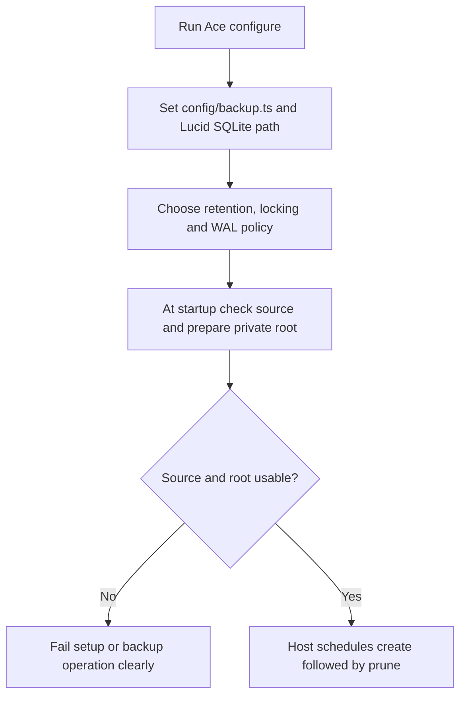
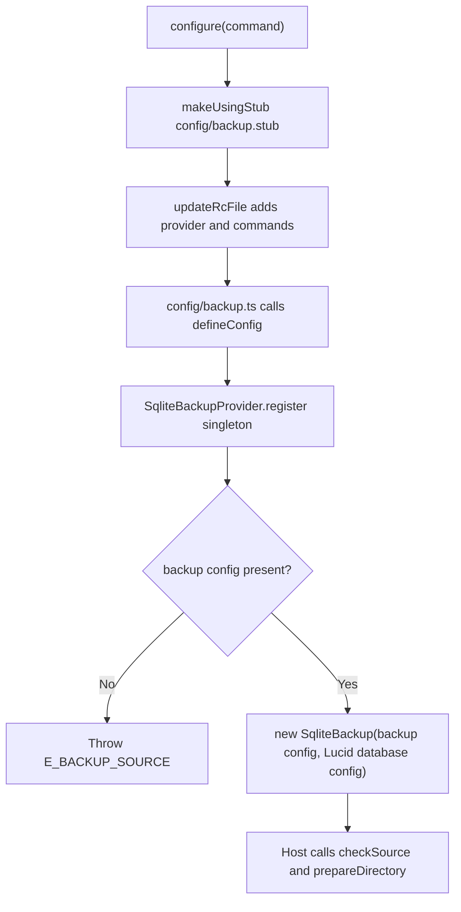

# US-SETUP-01 — Configure and prepare backup operations

As an application operator, I want to configure the Lucid connection, private backup directory and retention behavior so that manual, scheduled and restore-preparation actions use a known source and root.

**Status:** Operator; current configure and service setup path.
**Access:** Application operator able to configure Lucid and manage local filesystem permissions.
**Entry:** `node ace configure @kevinjohn/adonisjs-sqlite-backup`, `config/backup.ts`, and app startup call to `checkSource()`/`prepareDirectory()`.
**Documentation:** [Install](../../README.md#install), [service and configuration](../../README.md#service-and-configuration).
**Source:** [configure](../../configure.ts), [provider](../../providers/sqlite_backup_provider.ts), [defineConfig](../../src/define_config.ts), [directory preparation](../../src/directory.ts).
**Coverage:** [Configure tests](../../tests/configure.spec.ts), [config source tests](../../tests/config_source.spec.ts).

## Acceptance criteria

| Config key      | Control                   | Required/default/conditions                                                                  |
| --------------- | ------------------------- | -------------------------------------------------------------------------------------------- |
| `directory`     | `config/backup.ts` string | May be omitted/empty to disable configured operations; must be outside the live DB directory |
| `connection`    | Lucid connection name     | Optional; uses selected connection's source and migration table when available               |
| `keep`          | Integer                   | Defaults to 7; minimum 1                                                                     |
| `lockTimeoutMs` | Integer milliseconds      | Defaults to 0; minimum 0                                                                     |
| `requireWal`    | Boolean                   | Defaults to false; true refuses sources not in WAL mode                                      |

- Ace configure writes config stub and registers provider plus `db:backup` command. Provider binds `sqlite.backup` from backup and Lucid config.
- `defineConfig` validates `keep` and `lockTimeoutMs`; absent directory disables configured service operations, while a read-only `--directory` override remains available to list/verify/restore-prepare.
- At host startup, `checkSource()` can fail fast without making a bundle; call `prepareDirectory()` once to create/tighten the root to `0700` before scheduling create then prune.
- Create/prune do not recreate a vanished root. Manual create prepares its configured root. Host owns scheduling and any later switch to a staged restore file.

## User flow

## Code flow

Scope: configuration stub and provider service binding; scheduling is host-owned.

**Code references:** [configure hook](../../configure.ts), [provider](../../providers/sqlite_backup_provider.ts), [config validation](../../src/define_config.ts), [directory](../../src/directory.ts), [README startup contract](../../README.md#service-and-configuration).
