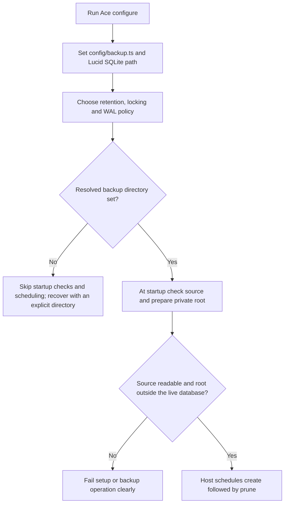
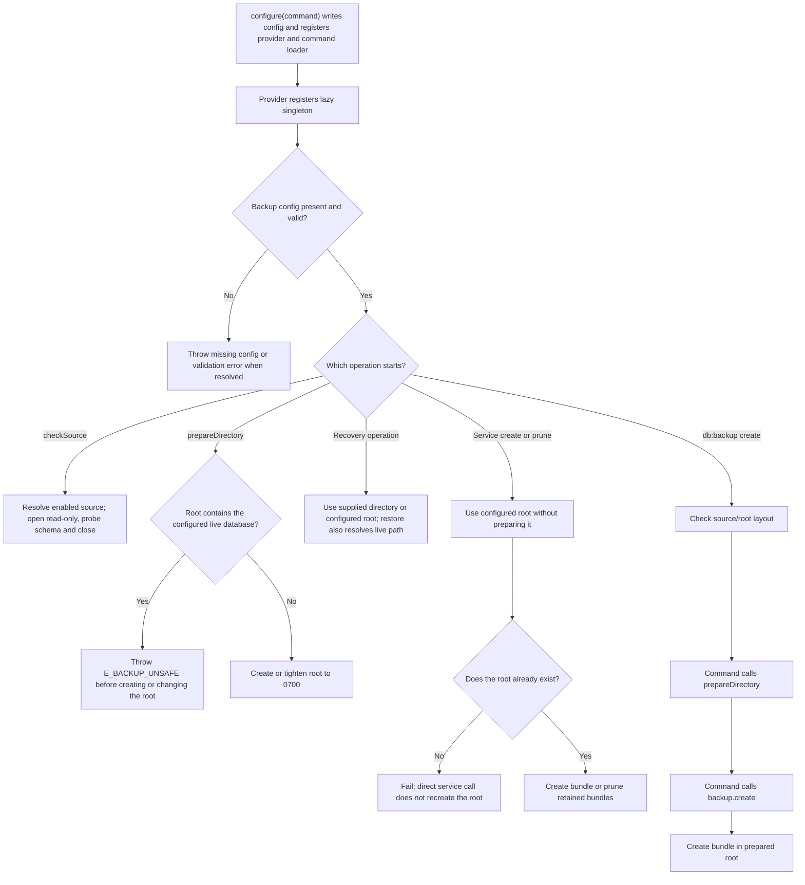

# US-SETUP-01 — Configure and prepare backup operations

As an application operator, I want to configure the Lucid connection, private backup directory and retention behavior so that manual, scheduled and restore-preparation operations use a known source and root.

**Status:** Operator; current configure and service setup path.
**Access:** Application operator able to configure Lucid and manage local filesystem permissions.
**Entry:** `node ace configure @kevinjohn/adonisjs-sqlite-backup`, `config/backup.ts`, and app startup calls to `checkSource()`/`prepareDirectory()` when the resolved `backup.config.directory` is set.
**Documentation:** [Install](../../README.md#install), [service and configuration](../../README.md#service-and-configuration).
**Source:** [configure](../../configure.ts), [provider](../../providers/sqlite_backup_provider.ts), [defineConfig](../../src/define_config.ts), [backup service](../../src/sqlite_backup.ts), [pruning](../../src/prune.ts), [directory preparation](../../src/directory.ts), [backup command](../../commands/db_backup.ts).
**Coverage:** [Configure tests](../../tests/configure.spec.ts), [config source tests](../../tests/config_source.spec.ts).

## Acceptance criteria

| Config key      | Control                   | Required/default/conditions                                                                                                             |
| --------------- | ------------------------- | --------------------------------------------------------------------------------------------------------------------------------------- |
| `directory`     | `config/backup.ts` string | May be omitted/empty to disable configured operations; backup root must not contain the live database; a sibling backup folder is valid |
| `connection`    | Lucid connection name     | Optional; defaults to Lucid's configured connection; uses its source and migration table when available                                 |
| `keep`          | Integer                   | Defaults to 7; minimum 1                                                                                                                |
| `lockTimeoutMs` | Integer milliseconds      | Defaults to 0; range 0–2,147,483,647                                                                                                    |
| `requireWal`    | Boolean                   | Defaults to false; true refuses sources not in WAL mode                                                                                 |

- Ace configure requires the host's `@adonisjs/assembler` for codemods, writes the config stub and registers the provider and the package command loader (`@kevinjohn/adonisjs-sqlite-backup/commands`), which provides `db:backup` and `db:upgrade`. Upgrade additionally needs Lucid's command registration. The provider binds `sqlite.backup` from backup and Lucid config; the boot-aware `@kevinjohn/adonisjs-sqlite-backup/services/main` import resolves the same singleton.
- `defineConfig` validates `keep` and `lockTimeoutMs` and the types of `connection`, `directory` and `requireWal`; absent or empty directory disables configured service operations, while a read-only `--directory` override remains available to list/verify/restore-prepare.
- At host startup, check the resolved `backup.config.directory` first. When it is empty, configured backups are disabled: the provider still boots, `checkSource()`, `prepareDirectory()`, `create()` and `prune()` would throw `E_BACKUP_DISABLED`, so the host skips them and schedules nothing, and recovery reads take an explicit directory. When it is set, `checkSource()` can fail fast without making a bundle; call `prepareDirectory()` once to create/tighten the root to `0700` before scheduling create then prune. `prepareDirectory()` refuses a root that contains the configured live database with `E_BACKUP_UNSAFE` before creating or changing anything. An unreadable source or unsafe root still throws and stops startup.
- Service calls to `create()` and `prune()` require an existing backup root and do not recreate a vanished one. The `db:backup create` command calls `prepareDirectory()` before `create()`; callers using the service directly must prepare the root themselves. Host owns scheduling and any later switch to a staged restore file.
- A caller using exported `acquireLock(directory, timeoutMs)` directly must provide an existing private directory on a local filesystem, with ancestors writable only by trusted users or sticky as described in the README limits. `acquireLock` itself does not check root privacy. Keep the returned lock referenced through `release()`. `.backup.lock` contains no application data. Damaged-lock repair refuses multiply linked files before truncation; do not create hard-link aliases to it.

- If the app resolves the singleton without a backup config, the provider raises `E_BACKUP_SOURCE` with the configure command. Missing config differs from a present config with an empty directory, for which archive overrides are available. [Provider](../../providers/sqlite_backup_provider.ts), [application tests](../../tests/app.spec.ts)

## User flow

## Code flow

Scope: operator setup and backup-root behavior in service and command entry points; scheduling is host-owned.

**Code references:** [configure hook](../../configure.ts), [provider](../../providers/sqlite_backup_provider.ts), [config validation](../../src/define_config.ts), [service preparation, create and prune](../../src/sqlite_backup.ts), [prune root check](../../src/prune.ts), [direct lock export](../../index.ts), [lock implementation](../../src/lock.ts), [db:backup create preparation](../../commands/db_backup.ts), [README startup contract](../../README.md#service-and-configuration).
