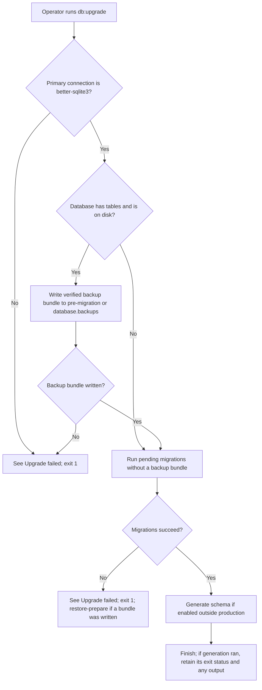
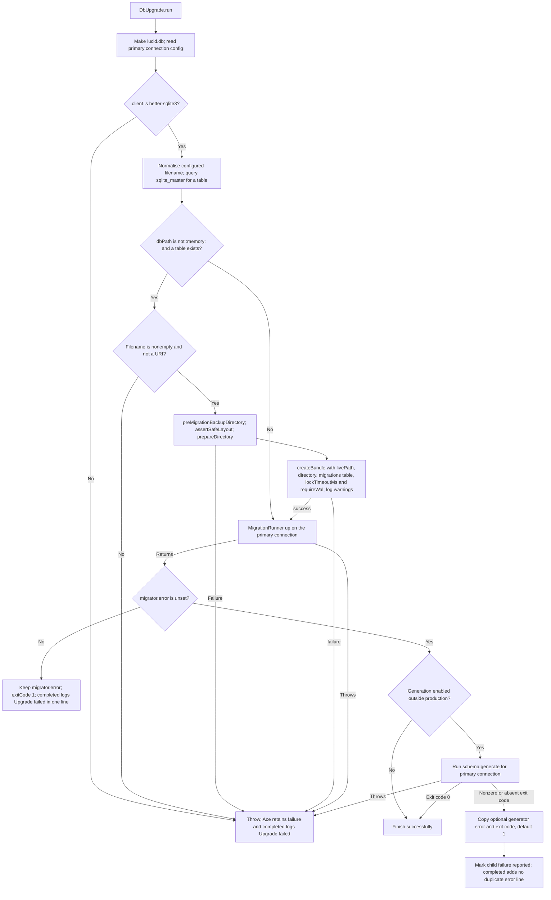

# US-OP-06 — Back up, then migrate the database

As a host operator, I want the `db:upgrade` Ace command to create a verified pre-migration backup bundle of the SQLite database before running pending migrations so that a failed or unwanted migration has a recovery point.

**Status:** Operator; current Ace command.
**Access:** Host operator with access to the Lucid `better-sqlite3` primary connection. Schema generation uses the `@adonisjs/lucid/commands` loader registered by the [configure hook](../setup/us-setup-01-configure-backups.md). For a file-backed database with tables, the operator also needs a writable pre-migration backup location.
**Entry:** `node ace db:upgrade [--no-schema-generate]`; run as an operator task, not in a web request.
**Documentation:** [Upgrading a database](../../README.md#upgrading-a-database).
**Release note:** Since v0.3.0, the pre-migration backup bundle uses the primary connection's migrations table and the backup configuration's `lockTimeoutMs` and `requireWal`, and reports non-WAL warnings.
**Source:** [DbUpgrade.run](../../commands/db_upgrade.ts), [preMigrationBackupDirectory](../../src/upgrade.ts), [createBundle](../../src/bundles.ts), [command loader](../../commands/main.ts).
**Coverage:** [Upgrade tests](../../tests/upgrade.spec.ts).

## Acceptance criteria

| Option                 | Control      | Required/default/conditions                                                                        |
| ---------------------- | ------------ | -------------------------------------------------------------------------------------------------- |
| `--no-schema-generate` | Boolean flag | Optional; `--schema-generate` defaults to true. When off, skip the separate schema-generation step |

- The command refuses with `Upgrade failed: …` and exit code 1 when the primary connection is not `better-sqlite3`.
- A database with no row of type `table` in `sqlite_master`, or an in-memory database, is migrated without a pre-migration backup bundle. Views or SQLite header metadata alone do not meet the table condition.
- Otherwise it writes a verified bundle to `pre-migration` under the configured backup `directory`, or to `<database>.backups` beside the database when no directory is configured, and reports `Pre-upgrade backup written <path>`. A distinct `pre-migration` child is outside the configured root’s immediate retention scan; a symlink resolving it to the root or later configuring the fallback as the root subjects those bundles to retention.
- The bundle uses the primary connection's migrations table (`migrations.tableName`, default `adonis_schema`) and the backup config's `lockTimeoutMs` and `requireWal`, as `db:backup create` does. A non-WAL source is reported as a warning, or refused with `requireWal: true`.
- If the bundle cannot be written, nothing is migrated and the command exits 1. Otherwise it runs the pending migrations with Lucid's migration runner, logging each migrated file or `Already up to date`. A migration failure is reported as one `Upgrade failed: …` line without a stack trace, exits 1, keeps the migration error in `error` and skips generation. After success outside production, schema generation runs by default on the primary connection. A nonzero or absent generator exit code becomes the command's exit code (default 1), and any generator error is retained. `completed()` adds no `Upgrade failed` line for the child failure; any child-owned output remains.

## User flow

## Code flow

Scope: `DbUpgrade.run` through migration and optional schema generation. The [create story](../create-bundle/us-op-01-create-bundle.md#code-flow) traces the shared bundle publication and cleanup.

**Code references:** [command](../../commands/db_upgrade.ts), [pre-migration backup directory](../../src/upgrade.ts), [createBundle](../../src/bundles.ts), [upgrade tests](../../tests/upgrade.spec.ts), [README upgrade contract](../../README.md#upgrading-a-database).
