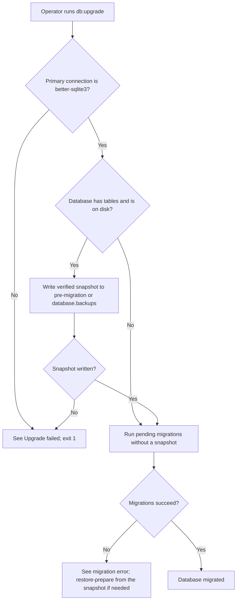
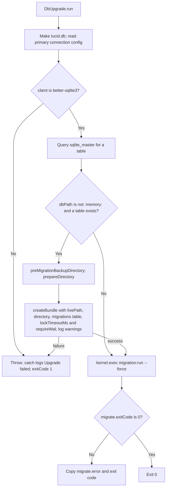

# US-OP-06 — Back up, then migrate the database

As a host operator, I want `db:upgrade` to take a verified snapshot of the SQLite database before running pending migrations so that a failed or unwanted migration has a recovery point.

**Status:** Operator; current Ace command.
**Access:** Host operator with a readable live database, a writable snapshot location and Lucid registered with a `better-sqlite3` primary connection, and `@adonisjs/lucid/commands` registered because `db:upgrade` runs `migration:run` through the Ace kernel.
**Entry:** `node ace db:upgrade [--no-schema-generate]`; run as an operator task, not in a web request.
**Documentation:** [Upgrading a database](../../README.md#upgrading-a-database).
**Release note:** Since v0.3.0, the snapshot uses the primary connection's migrations table and the backup configuration's `lockTimeoutMs` and `requireWal`, and reports non-WAL warnings.
**Source:** [DbUpgrade.run](../../commands/db_upgrade.ts), [preMigrationBackupDirectory](../../src/upgrade.ts), [createBundle](../../src/bundles.ts), [command loader](../../commands/main.ts).
**Coverage:** [Upgrade tests](../../tests/upgrade.spec.ts).

## Acceptance criteria

| Option                 | Control      | Required/default/conditions                                                                                      |
| ---------------------- | ------------ | ---------------------------------------------------------------------------------------------------------------- |
| `--no-schema-generate` | Boolean flag | Optional; `--schema-generate` defaults to true. When off, `--no-schema-generate` is passed on to `migration:run` |

- The command refuses with `Upgrade failed: …` and exit code 1 when the primary connection is not `better-sqlite3`.
- A database with no row of type `table` in `sqlite_master`, or an in-memory database, is migrated without a snapshot. Views or SQLite header metadata alone do not meet the table condition.
- Otherwise it writes a verified bundle to `pre-migration` under the configured backup `directory`, or to `<database>.backups` beside the database when no directory is configured, and reports `Pre-upgrade backup written <path>`. These bundles are outside `db:backup prune` retention.
- The snapshot uses the primary connection's migrations table (`migrations.tableName`, default `adonis_schema`) and the backup config's `lockTimeoutMs` and `requireWal`, as `db:backup create` does. A non-WAL source is reported as a warning, or refused with `requireWal: true`.
- If the snapshot cannot be written, nothing is migrated and the command exits 1. Otherwise it runs `migration:run --force`; a failed migration exits with that command's exit code.

## User flow

## Code flow

Scope: `DbUpgrade.run` through the `migration:run` exit code.

**Code references:** [command](../../commands/db_upgrade.ts), [snapshot directory](../../src/upgrade.ts), [createBundle](../../src/bundles.ts), [upgrade tests](../../tests/upgrade.spec.ts), [README upgrade contract](../../README.md#upgrading-a-database).
