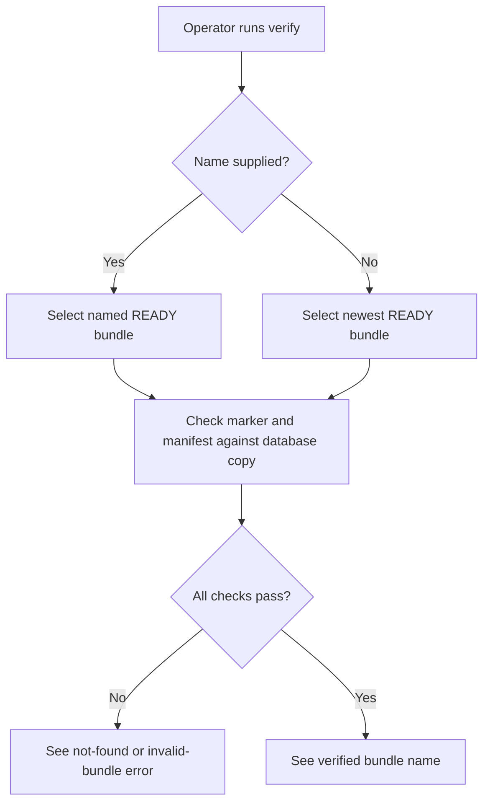
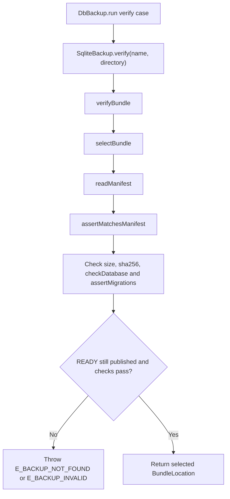

# US-OP-03 — Verify a published backup bundle

As a host operator, I want to verify a named or newest backup bundle so that I can check its marker, manifest, database bytes and SQLite integrity before relying on it.

**Status:** Operator; current Ace and public service operation.
**Access:** Operator able to read configured or explicitly selected backup directory.
**Entry:** `node ace db:backup verify [--bundle name] [--directory path]`.
**Documentation:** [Command behavior](../../README.md#commands), [bundle validation contract](../../README.md#errors).
**Source:** [DbBackup.run](../../commands/db_backup.ts), [SqliteBackup.verify](../../src/sqlite_backup.ts), [verifyBundle](../../src/bundles.ts).
**Coverage:** [Review tests](../../tests/review.spec.ts), [verify/restore tests](../../tests/verify_restore.spec.ts).

## Acceptance criteria

| Option        | Control     | Required/default/conditions                                      |
| ------------- | ----------- | ---------------------------------------------------------------- |
| `--bundle`    | String flag | Optional; selects a named bundle; newest READY bundle otherwise  |
| `--directory` | String flag | Optional read-only root override; configured directory otherwise |

- `verifyBundle()` selects a real directory, requires READY, parses the format-1 manifest, and checks file size, SHA-256, full SQLite integrity/foreign-key checks, and optional migration metadata.
- A missing bundle is `E_BACKUP_NOT_FOUND`; unreadable/mismatched content is `E_BACKUP_INVALID`. If prune unpublishes the selected bundle during verify, the operation reports not found rather than a false invalid result.
- Verification is read-only and lock-free; a concurrent prune may cause the operation to fail.

## User flow

## Code flow

Scope: lock-free bundle selection and verification.

**Code references:** [command](../../commands/db_backup.ts), [service](../../src/sqlite_backup.ts), [verifyBundle and assertions](../../src/bundles.ts), [checks](../../src/checks.ts), [verify tests](../../tests/verify_restore.spec.ts).
